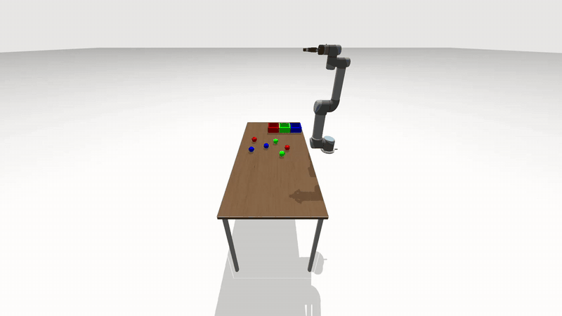
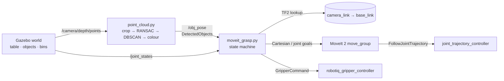
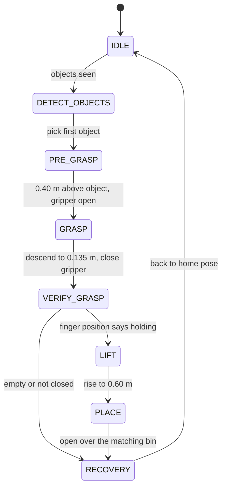

# Vision-Based Pick and Place (UR5 + Robotiq 2F-85)

A UR5 arm in Gazebo sorts coloured objects into matching bins. It uses a depth camera, point-cloud perception with Open3D, and motion planning with MoveIt 2.

The objects are placed at random positions on a table, and a camera looks down at it. The perception node finds each object and its colour. A state machine then moves the arm to each object, grasps it, checks that the grasp worked, and drops it in the bin of the same colour.



*A full run of all 6 objects, played at 3x speed.*

**Stack:** ROS 2 Humble · Gazebo Fortress · MoveIt 2 (via [pymoveit2](https://github.com/AndrejOrsula/pymoveit2)) · Open3D · Python

---

## Features

- **Full simulation:** a UR5 with a Robotiq 2F-85 gripper and an RGB-D camera, in a custom table world with 6 objects and 3 bins.
- **Random object placement:** every run puts the 6 objects at new random spots on the table, at least 10 cm apart.
- **3D perception:** the point cloud is cropped to the table, the table plane is removed with RANSAC, the remaining points are grouped into objects with DBSCAN, and each object is classified by colour.
- **Frame handling:** object positions are converted from the camera frame to the robot base frame with TF2.
- **Motion planning:** MoveIt 2 Cartesian paths, with the table added as a collision object.
- **State machine:** separate pre-grasp, grasp, verify, lift, place and recovery states.
- **Grasp check:** the gripper's finger position tells the robot whether it is actually holding something.

## Architecture



### State machine



## Repository structure

| Package | What it is |
|---|---|
| `ur5_arm` | **Main code:** `point_cloud.py` (perception) and `moveit_grasp.py` (pick-and-place state machine) |
| `ur5_msgs` | Custom messages: `DetectedObject` (id, colour, point) and `DetectedObjects` |
| `ur5_moveit_config` | MoveIt 2 config for the UR5 and gripper, made with the setup assistant, plus `pick_and_place.launch.py`, which starts everything |
| `ur_description` | UR description, with the gripper, the camera (`urdf/camera.xacro`) and the table world (`world/table_world.sdf`) added |
| `ur_simulation_gz` | Gazebo launch files, including `spawn_ur5.launch.py`, which brings up the simulation |
| `pymoveit2` | Python interface to MoveIt 2 (third-party, included for convenience) |

## Requirements

- Ubuntu 22.04
- ROS 2 Humble with MoveIt 2
- Gazebo Fortress (`ros-humble-ros-gz`, `ros-humble-gz-ros2-control`)
- Python 3.10 with Open3D:

```bash
/usr/bin/python3 -m pip install --user open3d==0.18.0 "numpy<2"
```

## Build

```bash
mkdir -p ~/ur5 && cd ~/ur5
git clone https://github.com/SamruddhiThorat07/vision-based-pick-and-place.git src
source /opt/ros/humble/setup.bash
rosdep install --from-paths src --ignore-src -r -y
colcon build
```

## Run

```bash
cd ~/ur5 && source /opt/ros/humble/setup.bash && source install/setup.bash
ros2 launch ur5_moveit_config pick_and_place.launch.py random:=true
```

This one command starts Gazebo, the controllers and perception, and places the objects at random positions. It then starts MoveIt, RViz and the pick-and-place node 10 s later, once the controllers are up.

The arm then picks up each object and drops it in its bin. When the table has been empty for 3 s, it prints `Pick and place successful`.

### Useful checks

```bash
ros2 control list_controllers        # all controllers should be "active"
ros2 topic echo --once /obj_pose     # what perception currently sees
ros2 topic hz /camera/depth/points   # is the camera publishing?
```

## Results

| Object layout | Runs | Objects per run | Sorted into the correct bin |
|---|---|---|---|
| Random positions | 5 | 6 (2 red, 2 green, 2 blue) | **28 / 30 (93%)** |

## Acknowledgements

- [Universal Robots ROS 2 description and Gazebo simulation](https://github.com/UniversalRobots)
- [pymoveit2](https://github.com/AndrejOrsula/pymoveit2) by Andrej Orsula
- Table, sun and ground models from [Gazebo Fuel](https://app.gazebosim.org/)
